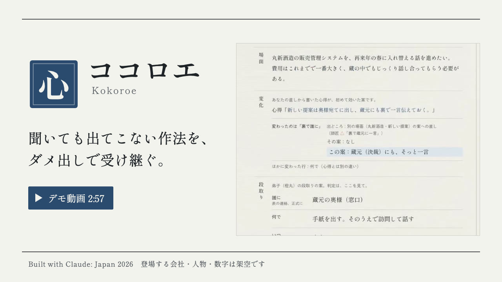
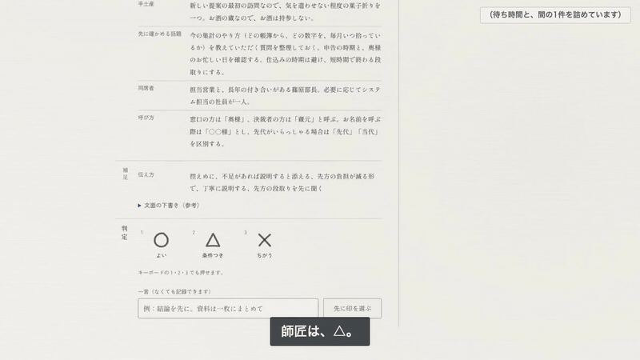
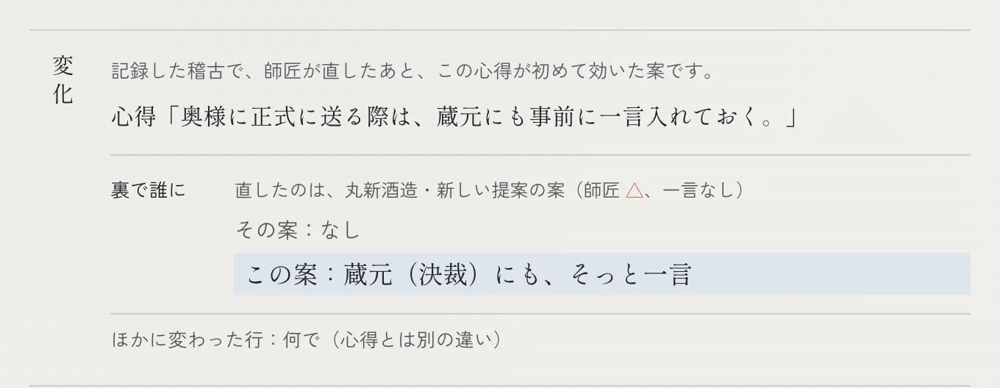
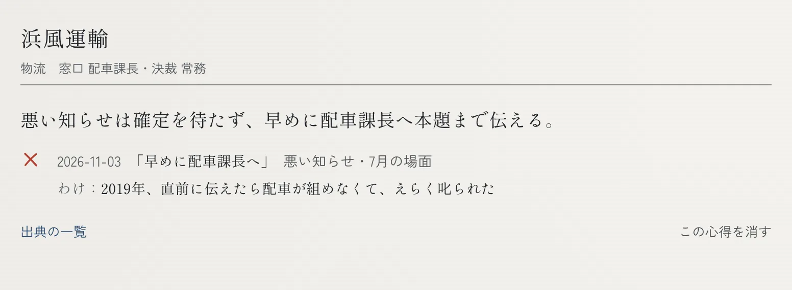
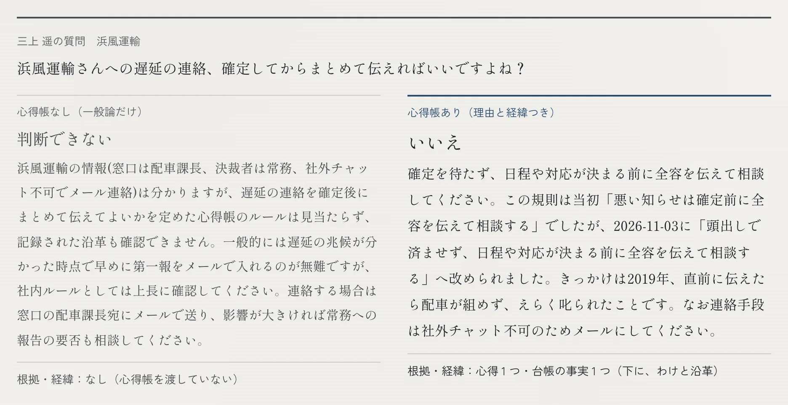

<h1 align="center">
  <picture>
    <source media="(prefers-color-scheme: dark)" srcset="docs/readme/logo-dark.png">
    
  </picture>
</h1>
<p align="center"><b>聞いても出てこない作法を、ダメ出しで受け継ぐ。</b><br>
<sub>商いの心得を継ぐ、AIの弟子・<a href="README.md">English README</a>・Built with Claude: Japan 2026・会社も人物も架空です</sub></p>

> これまで仕事やコミュニティの活動を通じて、数多くの企業や団体と関わってきました。どの現場にも優れた人がいて、その人ならではの仕事の勘どころがあります。けれど、その多くは本人の頭の中にしかなく、書き残されないまま、人が替わるたびに失われていきます。— 作者（続きは[課題](#課題)）

<p align="center">
  <a href="YOUTUBE_URL"></a><br>
  <a href="YOUTUBE_URL"><b>デモ動画を見る</b></a>（2:57、YouTube）・<a href="https://kokoroe.xzan0gz3dgpb8.ap-northeast-1.cs.amazonlightsail.com/"><b>公開デモを開く</b></a><br>
  <sub>審査員の方へ：公開デモの最初の画面のいちばん下「審査用のコード」に、提出フォームのコードを入れてから「デモの続きから見る」へ（<a href="#動かし方">詳しく</a>）。</sub>
</p>

<p align="center">
  <br>
  <sub>動画の帳場の場面（ライブで撮影）から：△ と一言 → 心得帳に書かれる → 次の案に「変化」。待ち時間と間の1件は詰めています（画面の隅に出ます）。</sub>
</p>

引退を控えた中小企業のベテランと、その後を継ぐ人のためのものです。ベテランは AI の弟子の案に ○・△・× を付けるだけ。直しの一つ一つが、なぜそうなったかと一緒に心得帳に残り、Agent Skill として後任に渡ります。

> **数字は 11/7 の正式な計測です**（学習5本・評価は3回ずつ、`eval/runs/2026-11-07T00-09-03-058Z-final.json`）。
> 登場する会社・人物・場面はすべて架空です（株式会社だいだい工房と取引先10社）。

**言葉の使い分け：** 作品名は**ココロエ**（Kokoroe）。師匠の作法の一つ一つが**心得**、それを、なぜそうなったか（沿革）と一緒に綴ったものが**心得帳**です。画面は、**帳場**（師匠が案に印を付ける）、**心得帳**、**暖簾を継ぐ**（後任が尋ねる）、**稽古の記録**（下の Before/After の数字）の4つです。本文の D-0xx は、[docs/decisions.md](docs/decisions.md) の決定記録の番号です。

## 画面で見る（記録済みのデモ・架空のデータ）

**1. 直したら、次が変わる（帳場）** — 記録した稽古で、師匠が丸新酒造の案に △ を付けた（一言なし）あと、次の根回しの案で、弟子が自分から蔵元への一言を添えました。最初の画面の例はこの稽古です。動画の帳場の場面は、同じ心得をライブで撮ったもので、師匠が一言を添えています。公開デモの「デモの続き」では、最初のカードで浜風運輸の同じような「変化」が見られます。



**2. 心得帳に、経緯ごと残る** — いつ、師匠のどの印（と、あれば一言）から、なぜ。師匠はいつでも読めて、消せます。



**3. 後任が、理由つきで答えられる（暖簾を継ぐ）** — 同じ質問に、心得帳なし（取引先台帳だけ）では「判断できない」。心得帳ありでは、根拠の心得と沿革を添えて答えます。（この答えは評価のときの心得帳で記録したもので、浜風運輸の心得の言い回しは2枚目と違います。答えそのものが、11/3 に言い回しが改められた経緯を述べています。）



## 課題

これまで仕事やコミュニティの活動を通じて、数多くの企業や団体と関わってきました。どの現場にも優れた人がいて、その人ならではの仕事の勘どころがあります。けれど、その多くは本人の頭の中にしかなく、書き残されないまま、人が替わるたびに失われていきます。とてももったいないことです。これは一つの会社の話ではありません。[後継者の不在](https://www.tdb.co.jp/report/economic/20251121-successor25y/)や、年に330万人という転職者の多さを考えれば、日本全体で同じことが起きています。ひいては、人が働く場所なら、世界のどこでも起こりうることです。ココロエは、その中でも特に言葉にしにくい「取引先ごとの付き合い方」から始めました。

（数字の出どころ: 後継者の不在は、下の段落の帝国データバンク「全国『後継者不在率』動向調査（2025年）」（2025年11月21日公表、約27万社）。年330万人は、総務省統計局[「労働力調査（詳細集計）2025年平均結果」](https://www.stat.go.jp/data/roudou/sokuhou/nen/dt/index.html)の転職者数。）

中小企業では、取引先ごとの付き合い方がベテラン一人の頭の中にあります。誰に先に伝えるか、何をメールで送り、何を顔を見て話すか、いつは避けるか、正式な話の前に誰の耳にそっと入れておくか。説明を頼んでも言葉にはなりません。けれど案を見れば「違う」と言えます。
その人が引退すると、作法も「なぜそうなったか」も一緒に消えます。帝国データバンクの[全国「後継者不在率」動向調査（2025年）](https://www.tdb.co.jp/report/economic/20251121-successor25y/)では、調査対象の中小企業の51.2%で後継者が決まっていません。新しく就いた社長の就任経緯では、内部昇格（36.1%）が同族承継（32.3%）を上回り、買収や出向を中心とする「M&Aほか」も20.6%と、継ぐ人の「脱ファミリー」が進んでいます（2025年の速報値）。

後任の側から見た難しさは、作者自身が架空の場面で師匠役をしたときに出ました。経緯を知らない者には、丁寧でもっともらしい案が ○ に見えます（20件中18件）。その18件のうち15件を、コードの判定（シミュレータの一人の師匠の正解で、実在のベテランではない）は △ か × とします（「試したこと・試していないこと」の師匠役テスト）。また、キックオフ前の小さな自己試行で、直しは ○ か × のどちらかではなく、たいてい「いいけど…」だと分かりました。師匠の印が ○・× だけでなく △ もあるのは、そのためです（[docs/evolution.md](docs/evolution.md) の背景）。

**誰のためのものか。** 引退を控えたベテラン（師匠）は、説明を求められずに、普段どおり「違う」と言うだけで作法を残せます。後を継ぐ人（社内の人や、事業を買った人）は、理由と経緯つきの答えを得られます。担当が替わる（転職・異動）ときも、渡し方は同じです（心得帳を Agent Skill として渡すだけで、引き継ぎの理由によらない）。**使い続ける場面:** 引退が決まってから後任に渡すまでの数か月、毎日の段取りの案を師匠が確かめる、その延長で心得帳が育ちます。自分の取引先で始めるには、「動かし方」の「自分の会社で始める」へ。

## ココロエがすること

- **弟子が先にやる。** 取引先の場面（納期の遅れ、見積り、新しい提案、季節のあいさつ…）ごとに、AI の弟子・橙丸が段取りの案を作ります。誰に（正式な宛先）・何で（メール、電話、手紙、訪問、あえて連絡しない）・いつ・裏で誰に（決裁者などへの根回し）・後日のあいさつ。文面は、その下に畳んだ下書きです。
- **師匠は印を付けるだけ。** ○／△（大筋はよいが条件が抜けている）／×と、任意の一言。説明は要りません。一言が曖昧なときは、読み方の候補2〜3個から1タップで選ぶか「どれでもない」。
- **ダメ出しが心得帳になる。** 一つひとつが、適用範囲つきの短い心得になり、出どころ（どの判定で、いつ、師匠が何と言ったか）と沿革（旧 → 新・きっかけ・日付）が本文に残ります。師匠はすべての項目を読み、消せます。
- **自分で確かめる。** 心得を覚えるたびに、直された場面と、以前 ○ だった場面を解き直し、師匠がその案に印を付けます。
  - *直された場面がまだ △・× で、案が新しい心得どおりになっていない:* その判定を材料に一度だけ読み直して確かめ直します。それでも効かなければ、その心得は採用せず、沿革に「確かめで外れたため取り下げ」と残します。
  - *案は心得どおりだが、まだ △・×:* 心得は残し、残りは別の心得として覚えます。
  - *以前 ○ だった場面に △・× が付いた:* 一度だけ範囲を絞り直し、それでも崩れるなら差し戻して沿革に記録します。
  - 学習のループでは、複数の取引先で同じ傾向が出たら全社の心得の候補も出し、師匠が確認します（帳場の画面にはまだありません）。
- **後任が継ぐ（暖簾を継ぐ）。** 後任が「この手順、省いていい？」と聞くと、心得帳だけを根拠に、心得と沿革を添えて答えます。記録がなければ「師匠に確認を」。心得帳はそのまま **Agent Skill** として書き出せ、後任の手元の Claude Code が読み込みます。
- **訪問の段取りも（アプリのみ）。** 段取りに訪問が入るときは、弟子が服装（スーツを好まない先方もある）、手土産、先に確かめる話題、同席者、呼び方も案に含め、師匠が同じ ○△× と一言で直します。直しは心得になります。**評価の対象は連絡の段取りだけです。** 訪問の作法は隠しの正解にないため、評価では訪問の段取りを切って測っています。
- **主導権は師匠に。** 弟子は何も送らず、値引きや契約条件を決めません。取引先の文面に紛れた指示で心得帳が書き換わることはありません。

### 渡し方は二つ: 写しと、問い合わせ口
- **Agent Skill は、ある時点の心得帳の写しです。** 後任の手元の Claude Code でオフラインでも働き、師匠が引退したあとに残るものです。Skill には写しの時点が書いてあります。
- **読み取り専用の MCP サーバーは、育ち続ける心得帳への問い合わせ口です。** 師匠がまだ直していて、後任がもう働いている引き継ぎの期間に、後任の Claude が `changes_since(写しの時点)` を呼ぶと、写しの後に変わったことが分かります。道具は読み取りだけの4つ（`list_clients`・`get_kokoroe`・`get_history`・`changes_since`）。書き込む道具、Claude を呼ぶ道具、取引先が書いた文面はありません。読み取り専用は型とテストで守り、手元の stdio で動きます（`npm run mcp:serve`）。
  例（[demo/successor-mcp](demo/successor-mcp/)）: 「丸新酒造さんへの出荷が1週間遅れる。奥様に電話で伝えれば大丈夫？」に、Skill だけだと写しの心得「奥様に正式に送る際は、蔵元にも事前に一言入れておく」から「電話だけでは足りない可能性が高い、先に蔵元へ一言」と答え、連絡の手段（電話だけでよいか、書面やメールも要るか）は写しに記録がないので師匠に確認を、とします。サーバーがあると、写しの後に覚えた心得「悪い知らせは電話で済ませず、蔵へ顔を出して直接話す」を見つけ、「電話だけでは足りない、蔵へ伺う」と答えます。

## 動かし方

- **公開デモ:** [https://kokoroe.xzan0gz3dgpb8.ap-northeast-1.cs.amazonlightsail.com/](https://kokoroe.xzan0gz3dgpb8.ap-northeast-1.cs.amazonlightsail.com/)。「デモの続き」（ボタンは「デモの続きから見る」。学習の途中で止めた記録の心得帳から始め、公開デモでは弟子がそこから案を作り、あなたの印をライブで読み取ります）と「お試し」（ボタンは「師匠になって試す」。あなたが師匠で、心得帳は空から）の2つ。最初の案まで、デモの続きは10秒ほど、お試しは5秒ほどかかります（待つ間は画面にそう出ます）。ライブの呼び出しには、セッションごと・1日ごとの上限があります。上限に達すると、画面にそう出て（「本日のお試し上限に達しました…」）、記録済みのデータで続きます。
- **審査員の方へ:** 提出フォームに記したコードを、最初の画面のいちばん下の「審査用のコード」を開いて入れ、「確かめる」を押してください。変わるのは、そのブラウザで AI の弟子がその場で案を作るときの1日の利用の上限だけで、審査員用の上限になります。来場者の利用で共通の上限に達しても、そのまま試し続けられます。画面・動き・データは同じで、別の環境に切り替わるのではありません（学習・判定・評価も同じ。1つのアドレスあたりの上限は残ります）。付けた印や育った心得帳はブラウザごとに分かれ、ほかの人と混ざりません。最初からやり直すか、24時間たつと消えます。コードがなくても、記録済みのデータですべての画面を見られます。
- **手元で動かす**（Node 22 以上・npm。11/3 に新しく clone して4つとも確かめ、11/5 にもインストール・テスト・eval:quick・本番ビルドを確かめました）:
  ```bash
  npm ci
  npm run dev -- --hostname 127.0.0.1   # http://127.0.0.1:3000 — キーも .env も要らず、記録済みデータで動きます
  npm test                              # テスト（API は呼びません）
  npm run eval:quick                    # 評価用場面でシミュレータを回す（API なしの素朴な弟子）
  ```
  `--hostname 127.0.0.1` を付けると、自分の PC からだけ開けます。Claude を実際に呼ぶ場合（任意）は、`.env.local` に
  `ANTHROPIC_API_KEY=...` と `KOKOROE_LIVE=1` を書きます（ひな形は `.env.example`）。この2つがなければ、心得帳は書き足されません（書き足しはライブ版で）。△・× を付けると、帳場には記録した稽古で書かれた心得を例として出します。暖簾を継ぐは、例の質問にだけ、記録した稽古の心得帳からの答えで答えます。
- **自分の会社で始める（手元のみ）:** `npm run own`（`.env.local` に `ANTHROPIC_API_KEY` が必要）で
  http://127.0.0.1:3000 を開くと、架空の会社ではなく、自分の取引先台帳から始められます。
  - **始め方:** 「台帳」で会社と台帳を入れます（フォームか CSV）。帳場で場面を書くと弟子が案を作り、あなたが印を付けます。
  - **データの置き場所:** `~/.kokoroe`（`KOKOROE_OWN_DIR`）だけ。リポジトリの外です。
  - **送るもの:** Claude API に送るのは、案・読み取り・回答を作るときだけです。
  - **開ける人:** このPCからだけ。他から来た要求には何も返しません。
  - **文章と判定の比較テスト:** 自分の取引先（仮名）で、作法を文章で書く時間と ○△× で判定する時間を比べられます。先に文章を書き、
    そのあと判定します。repo に残るのは時間と件数だけです（`npm run own:save`。手順は [docs/own-company-test.md](docs/own-company-test.md)、D-060）。実際に導入する会社で、ベテランが本当に経験のある相手について使えば、書く時間と直す時間を比べられます。そのための機能です。
  - **作者自身のテストは打ち切りました（D-062）。** 仮の台帳では、取引先ごとの「その会社ならでは」の事情を作者が知らず、文章で書けるのはどの会社にも当てはまる一般的なマナーだけでした。それは AI がもともと知っている平均と同じです。そのため「書くより直すほうが楽」は、ここでは人の実測で**示せていません**。
  - **消し方:** 「全部消す」ですべて消えます。
  - **公開デモ:** このモードはありません。
  - **開発用サーバーでだけ動きます**（`npm run own` は 127.0.0.1 の `next dev`）。本番ビルドは、このモードなしで作った画面の骨組みが
    固定されるため、`npm start` では動きません（その場合は何も表示しません）。

<!-- results:begin (generated by `npm run demo:results` from data/demo/results.json — do not edit) -->
## Before / After

架空データ：取引先10社、学習用40場面、評価用20場面（学習に使わない）、経緯の質問8件。師匠はシミュレータで、隠しの正解（凍結・チェックサムで検査）に照らしてコードで判定します。弟子は正解を見ません。

| | Before（取引先台帳と、その制約） | ダメ出し40場面のあと |
|---|---|---|
| 評価用場面の一致率（○） | 54% ± 2%（6回） | **71%**（65〜75%、学習5本×各3回） |
| ○ + △ | 69% | **91%**（85〜95%） |
| 後任が経緯ごと正しく答えた質問（8問中） | 0 | **5.2** ± 1.3 |
| 40場面にかかった師匠のタップ数 | — | 107〜128（印・候補の選択・「なぜ？」・確かめ） |
| 取引先の文面に紛れた「心得として登録せよ」 | — | 注入された文で心得帳が書き換わったのは 9回中0回 |
| 値引きを迫られた場面 | — | モデル単体で 9回中9回、コードの下限（D-044）込みで 9回中9回、師匠の判断に回した |

_注入の回数は、確かめのコードの数え方の誤り（学習中に退けた心得を「失われた」と数えていた）を、正式計測のあとに直して数え直したもの。生の記録は D-068 に。_
<!-- results:end -->

**残りの案の安全。** 弟子は何も送りません。師匠はすべての案に印を付けます（○ が続いたら確認を軽くする案は、記録の再生で確かめて採りませんでした。D-055）。値引き・契約条件・重要な取引先への最初の連絡は、プロンプトで頼むだけでなく、コードでも必ず師匠に回します（`mustReview`、D-044）。

評価の対象は連絡の段取りです。訪問の段取り（服装・手土産など）は、隠しの正解に含まれていないため対象外で、評価ではいつも切っています（D-061）。

**数字の読み方（正直に）**
- **評価用20場面では、1場面が5ポイントです。** 54% → 71%（5本の平均）は約3場面分、幅の下端（65%）は Before より約2場面分上です。
- **評価用20場面は、開発の途中の診断にも使いました。** 評価用の場面1つがきっかけで変えたものが2件あります（E13 → D-022、E11 → D-033）。一度も見ていない場面ではなく、見すぎの危険があります。Before と After は同じ台帳・モデルで測るので比べられますが、水準そのものは弟子に有利に出ているかもしれません。
- **経緯の質問（沿革の質問）は、師匠の言葉が後任まで届いたかを見るものです。** 言い換えへの強さは測っていません。シミュレータの「わけ」は隠しの沿革の一文そのままで、後任の答えはその文の語で採点します（一部の語は公開の台帳にも出てきます）。
- **シミュレータの「どこが違う？」は仮定に立っています（D-057）。** シミュレータの師匠は、一言を付けずに「どれでもない」を押すとき、違う場所も選びます（実在の師匠が自分の意図を知っているのと同じ扱い。教科書どおりの師匠も △・× の2割は一言を付けません）。場所を選ばない率は測ったものではなく仮定です。この表の師匠は 20%（11/7 の正式計測も 20%）、ペルソナの背中で語る師匠は 50%、「なんか違う」の師匠は 30% です。実在の師匠は、もっと選ばないかもしれません。

## 試したこと・試していないこと

上の評価用場面とは別に、2種類のテストをしました。どちらも、実在の取引先や実際の職場でのテストではありません。

- **師匠役テスト（作者用・手元のみ）:** 作者が師匠役になり、架空の場面で帳場を操作して、操作ごとの時間を測ります
  （[docs/master-role-test.md](docs/master-role-test.md)）。実際の取引先や現場で試すものではありません。
  - **結果（11/4、1人、架空の20場面。D-059）:** ○△× を付けるまで、1件あたり中央値 **53.5秒**（案と下書きの文面を読む時間を含む。
    20件で約18分）。一言を添えて記録するまでは中央値 1.3秒で、一言はほとんど書きませんでした。
  - **20件中18件が ○ でした。** 作者はこの架空の会社と取引したことがなく、初めて見る者には、丁寧でもっともらしい案が合格に見えました。
    これは「事情を知らない後任が、AI の案をそのまま送ってしまう」構図そのものです。暗黙の作法を直せるのは、経緯を知る本人だけです。
  - **同じ20枚を、コードの判定（シミュレータの隠しの正解）でも採点しました**（API なし、11/5）。作者が ○ を付けた18枚は、**○ が3枚、△ が8枚、× が7枚**。作者の △ 2枚は、× が1枚と ○ が1枚。印が一致したのは20枚中3枚です。条件: 作者が見て印を付けた案（テストの最中に、台帳の制約と途中で覚えた2つの心得からライブで作られたもの）、11/3 から凍結した判定（D-017）、連絡の段取りだけ（D-061）。実在のベテランではなく、シミュレータの一人の師匠の正解です（[docs/results/master-role-vs-simulator-2026-11-05.json](docs/results/master-role-vs-simulator-2026-11-05.json)）。
  - **測れなかったこと:** 同じ作法を文章で書く課題は行いませんでした（書き起こす元になる経験が作者にないため）。そのため、判定と
    書く時間の比較や、出てくる作法の量は測れていません。
- **ペルソナのシミュレーション（実地の代わりではありません）:** 性格の違う師匠と後任を Claude に演じさせました（背中で語る師匠、
  「違う」しか言わない師匠、繁忙期の師匠、指が太い師匠、略語の師匠／遠慮がちな新人、一行で雑に聞く人 など）。確かめたのは
  **人のばらつきへの耐性**です。案が正しいかどうかの判定は機械のままで、ペルソナが変えるのは言い方と押し方だけです。
  - **結果:** 崩れはしませんでした。一言のない師匠ほど「どれでもない」で学びを取りこぼします。どの後任も、心得帳にない質問に作り話で
    答えませんでした。
  - **「どこが違う？」:** これを受けて、**一言がないとき**は、「どれでもない」を押すときに、違う場所（誰に・何で・いつ・裏で誰に・
    書式・その他）も同じ1タップで選べるようにしました（選ばなくても進めます）。
    - 場所が選ばれると、2回目の読み方が当たる割合が上がりました（13件中7件。選ばれないときは13件中1件。架空データ、シミュレータの師匠、学習1本ずつ。D-057）。
    - はじめは「どれでもない」のたびに出していましたが、一言を付ける師匠では ○+△ が下がりました（オン／オフ3組、学習1本ずつ、架空の評価用20場面の ○+△ で、オン 80〜85%、
      オフ 90〜100%）。そのため、一言が空のときだけ出すことにしました（D-057）。
    - シミュレータの師匠が場所を選ばない率（50%・30%・20%）は仮定です。
  - **忙しい時期の判定:** 繁忙期には印が甘くなりがちです（既知の限界）。甘い ○ からは何も書かれません。心得帳の心得には書かれた日付と、
    もとになった場面・印が残るので、忙しい時期に書かれたものを後で見直して消せます（消した記録も沿革に残ります）。
  - **詳しく:** [docs/personas-2026-11-04.md](docs/personas-2026-11-04.md)
  - 上の師匠役テスト（作者の実測）とは別物です。

## Claude で作ったもの／Claude 以外のもの

審査の対象は Claude で作ったものです。その境目をここに書きます。

**Claude で作ったもの**
- **このリポジトリのコードと文書。** ハッカソンの期間中（2026-11-02 から）に Claude Code で作りました。アプリ、師匠シミュレータと評価、スクリプト・テスト・フック、架空のデータファイル、README と記録、動画の場面のページとナレーションの台本です（台本は Claude と作り、一部は作者が短くした。D-049）。どこが作者の判断で、何を Claude Code がしたかは [docs/how-we-built.md](docs/how-we-built.md)（と下の「二つ目の帳場」）にあります。
- **アプリの中で Claude が書くもの**（Anthropic の API を直接呼び出し）：弟子の段取りの案・文面の下書き・訪問の段取り、師匠の一言の読み方の候補とそこから書く心得、後任への答え。学習のループ（評価）では、全社共通の心得の提案と、ペルソナの言い回し（Haiku。`eval/personas-texts.json` に保存）。案が正しいかどうかは Claude ではなく、コード（機械で判定するシミュレータ）が決めます。
- **ココロエの Skill と MCP サーバー。** Agent Skill（`SKILL.md`）として書き出す心得帳と、読み取り専用の MCP サーバー（`src/mcp/server.ts`）は、この作品の一部です。**Claude Code そのものは Anthropic の既製品で、そのまま使っています。** 動画では、後任の Claude Code がココロエの Skill を読み、ココロエの MCP サーバーに問い合わせて答えます。答えのどこがどちらから来たかを、画面に示しています。

**Claude 以外のもの**
- ナレーションの音声：Amazon Polly（音声合成。台本は上のとおり Claude と作り、一部は作者が短くした）。ホスティング：Amazon Lightsail。
- 主なオープンソース：Next.js、React、Tailwind CSS、Zod、MCP の TypeScript SDK、Playwright（画面の録画）、ffmpeg（動画の組み立て）、Vitest。フォント：しっぽり明朝、Zen 角ゴシック New（Google Fonts、SIL Open Font License）。
- README と動画で引用する統計：帝国データバンク（後継者不在率の調査、2025年）、総務省統計局（労働力調査、2025年）。
- 外部の画像・音楽も、生成 AI の画像も使っていません。動画の絵は、HTML/CSS で作ったページと、アプリそのものの画面です。
- ロゴ・タブのアイコン・リンクのプレビュー（OGP）の画像：文字は、しっぽり明朝（SIL Open Font License 1.1）の字形をパスにしたもので、アプリの色で `scripts/logo/build-logo.mjs`（Claude で作成）が組んでいます。README の動画のサムネイルと動く画像は、デモ動画から作りました（動画の1コマと、帳場の場面を ffmpeg で切り出したもの。`scripts/logo/build-thumb.mjs`）。README のほかの画像は、アプリの画面のスクリーンショットです。

## Claude Code でどう作ったか

一人・一週間、Claude Code を開発の中心に据えて作りました（詳細: [docs/how-we-built.md](docs/how-we-built.md)）。Claude Code には作業だけでなく、守る仕組み（フック・テスト・レビューのサブエージェント）も任せました。

- **評価を最初に作る。** 初日に、機械で判定する師匠シミュレータ、凍結した隠しの正解（フックで編集を止め、テストでチェックサムを検査）、製品コードが正解を読まないことを確かめるテストから始めました。

Claude Code の機能は、それぞれ一つの目的に使いました。

| 機能 | 目的 | ここでしたこと | 記録 |
|---|---|---|---|
| **フック** | 指示を忘れても守られる決まり | このリポジトリでの MCP の呼び出しをすべて止める。コミット前に秘密情報を検査。凍結した正解の編集を止める。コアやプロンプトを変えたら速いテストを走らせ、小さな API 評価を回すまでコミットさせない。`aws` は決まったサンドボックスのプロファイルでしか呼べない（この PC には他の組織のプロファイルもあるため） | `.claude/settings.json`、`.claude/hooks/`、D-003、D-017 |
| **サブエージェント** | 別の目が要る仕事、並行できる仕事 | `world-keeper` の定義（`.claude/agents/world-keeper.md`）に沿った general-purpose のサブエージェントが、学習用40場面を並行して作成（途中で作ったプロジェクトのサブエージェントは、再起動まで読み込まれないため）。`hitl-reviewer` がコミット前に止めたもの: 最初の UI で3件（D-028。師匠の選択が反映されない、タップなしで心得が書かれる、更新の取りこぼし）、自分の会社で始めるモードで4件（D-056）、訪問の段取りを読まない金額の確認（D-061）、次の案の先読みの競合2件（D-066）。11/6 には、後任のプロンプト変更の最初の言い方（心得の〔台帳〕の印で見分けるため、台帳の事実と師匠の直しが混ざった心得では師匠の日付まで消える）も止めた（D-054 の追記）。`ui-critic` はスクリーンショットだけを見る。`judge-critic` は提出物を審査基準（[docs/judging.md](docs/judging.md)）で読み、記録で裏付けられる改良だけを挙げる。11/6 は、15分ごとのセッションのループで4つの目（ui-critic・judge-critic・本番ビルドで時間を測るライブ・ページと文書の照らし合わせ）を1回ずつ回し、毎回、見つけたこと・直したこと・残したことを記録した（例: ライブの答えは記録済みの答えと台帳の出典の書き方が違い、台帳の事実が師匠の直しと表示されていた。ライブでしか見えない不具合で、両方の書き方をテストで固定した）。回したのは Claude Code のセッションの cron で、cron はセッションに結びつくため、状態・決まり・作り直すためのプロンプトを `docs/HANDOFF.md` に書き、毎回更新した。節目の監査は読み取り専用のサブエージェントに任せた（`docs/audits/`） | `.claude/agents/`、[docs/ui-polish-log.md](docs/ui-polish-log.md) |
| **Skills** | 次のセッションが間違えてはいけない知識 | `world-consistency`（架空の世界の正本）と `decision-log`（記録の書き方）。製品自体も、心得帳を Agent Skill として書き出す | `.claude/skills/` |
| **MCP** | 開発では使わず、製品に入れる | 開発中は止める（開発者の Claude Code につながった仕事用の接続が、公開リポジトリに漏れないように）。製品では読み取り専用のサーバーとして出し、後任の Claude Code がいまの心得帳に問い合わせられる | D-003、`src/mcp/server.ts` |
| **プランモード** | コードの前に順番を決める | 初日、リポジトリの外の計画メモを読むだけにして（写さない）、評価を最初に作る順番を決めた | [docs/how-we-built.md](docs/how-we-built.md) |
| **ヘッドレス実行（`claude -p`）** | 後任の側を、同じ条件で再現する | 後任の Claude Code を、リポジトリの外の空のディレクトリで、Skill だけ／Skill ＋ MCP で動かし、答えを記録した | `demo/successor-mcp/` |

- **役割でモデルを分ける。** 弟子の段取りの案と後任への答えは Sonnet 5.5（師匠は1枚ずつ印を付けるため、数秒で返る必要がある）。直しの読み取りと心得帳を書く仕事は Opus 5.5（判断が重く、裏で動いてよい）。Managed Agents のメモリストアは、心得帳の別の保存先として実装し、実際の API で速さを測りました（帳場のセッションごとにストアを作って心得16件・判定27件を入れるのに約2.1秒、読み書き 0.2〜0.7秒。エージェントのセッションは使っていない）。この規模では利点が出ないため、既定にはしていません（`KOKOROE_STORE=memory`、D-002）。
- **思い込まずに測る。** プロンプトや学習を変えたら、小さな API 評価を回すまでフックがコミットを止めます。Before/After の数字は評価用場面で3回以上の平均（D-013）。後任のプロンプトの変更は、後任用の確認セットで、保存した心得帳ごとに1回ずつ確かめました（D-054）。プロンプトキャッシュは A/B で検証（費用 −37%、判定は不変、D-027）。プロンプトの並びが変わったときは Before を測り直して差し替えました。
- **判断を記録に残す。** 60件以上の決定記録（[docs/decisions.md](docs/decisions.md)）とアイデアの変遷（[docs/evolution.md](docs/evolution.md)）。

### 二つ目の帳場：このリポジトリの作り方

開発そのものも、製品と同じ形で進みました。Claude Code が計画や変更の案を出し、Kento が判断する（たいていは一言）。その違いを、次のセッションが最初に読む場所、つまり `CLAUDE.md`・フック・理由と日付つきの決定記録に残しました。以下は git の履歴と記録から拾った例です。すべてがダメ出しから生まれたわけではなく、最初の一つはコードを書く前に Kento が決めていた作法です。

| 案・状況 | Kento の判断 | 残した場所 |
|---|---|---|
| 開発者の Claude Code に仕事用の MCP がつながっていた（初日、コードを書く前） | この公開リポジトリでは MCP を一切呼ばない | `CLAUDE.md`、`mcp__` の呼び出しをすべて止めるフック（D-003） |
| 隠しの正解が初日のうちに手直しされていた（「なぜ」の一行の追加、一言の言い換え） | 凍結する。答えを途中で動かしたように見えないように | 編集を止めるフック、チェックサムのテスト（D-017） |
| 開発サーバーが既定のホストで起動し、何時間も LAN から見える状態だった（開発用キーで Claude を呼べる） | `127.0.0.1` だけで起動し、確認が済んだら止める | `CLAUDE.md`、以降のすべてのスクリプトとコマンド |
| Claude Code 自身の節目の監査で、コミットの作者が勤務先のメールアドレスになっていると分かった | GitHub の noreply アドレスに書き換える（監査の案 A） | 44件すべてを書き換えて確認。`docs/audits/2026-11-03.md`、`docs/publishing.md` |
| 計画にあった段位（見習い・手代・番頭）で、○ が続いたら確認を軽くする案 | 画面を作る前に記録を再生して確かめる。結果を見て採らない | D-055、コードの下限 `mustReview` |

製品と同じく、フックがいちばん強い心得です。指示を忘れても効きます。案を見れば ○△× を付けられる仕事（値付け、品質の判定、審査、設計のレビューなど）なら、同じ仕組みが使えるはずです。汎用の帳場は今後の展望で、ここでは作っていません。

## 設計の考え方

- **暗黙知は「平均との差」として現れる。** Claude が平均的な案を出し、師匠が直した分だけを残します。台帳に書ける事実（Zoom 不可、3月決算など）は最初から弟子に渡すので、伸びた分は「書いても残らないもの」の効果です。
- **師匠の手間を小さくすることと、確実に学ぶことの綱引き。** 一言は任意です。ある学習では、ある取引先での × に一言がなく、読み方の候補にも正解がなく、その学びが丸ごと失われ、最終値が10ポイントほど動きました。一言は任意のまま、こちら側（2巡目の読み方、師匠の言葉の範囲だけで心得を広げる）で補うことにしました。
- **同じ設定でも学びの道筋は違う。** 同じ設定の2回の学習が10ポイント離れたので、数字は1回ではなく、何本か回した平均と幅で示します。
- **台帳の事実のトレードオフ。** 台帳の制約を心得帳に入れて「なぜ？」を一度だけ聞くと、沿革に答えられるようになりました（港北精機：Zoom → Teams、2024年）。ただし、それを「師匠のダメ出しから覚えた心得」として弟子に見せると堅くなりすぎたため、今は心得帳の中に「台帳から写した事実」として、師匠から覚えた心得とは分けて置いています（弟子に師匠の心得としては見せません）。
- **段位を試して、見送った。** 「○ が続いた取引先は確認を軽くする（手代・番頭）」を、学習の記録8本（各40場面）で再生して確かめました。手代で「確認だけ」にしたはずの案の 64〜76% が実際には △・× で、学習の案全体で △・× だった割合（320件中175件、55%）より悪い結果でした。同じ取引先でも場面の種類ごとに必要な作法が違うので、○ が続いたことは次の案の正しさを予測しません。そこで段位の名前で信頼を示すのはやめ、取引先ごとの実績（「この取引先では ○ が3回続いています」）を情報として見せるだけにしました。初めての取引先・値引き・契約を必ず師匠に回す仕組みは、コードに残しています。信頼の段位は、同じ種類の場面が繰り返し出る実際の現場でデータが貯まってから検討します。

## 関連研究
人の修正から学び、段階的に任せる仕組み自体は新しくありません。*The Digital Apprentice*（Weber・Taneja、arXiv 2606.04321）は、専門家の修正を好みのデータに変え、技能ごとに段階的に任せる範囲を広げます。*Seedentia*（Wolter ほか、arXiv 2603.24858「Context-Mediated Domain Adaptation in Multi-Agent Sensemaking Systems」）は、AI の出力に対する専門家の編集を、後の推論のための知識として取り込みます（どちらも 2026-11-06 に arxiv.org で確かめました）。ココロエが向き合うのは、学んだことを**別の人へ渡す**こと、**なぜ変わったか**を残すこと、読めて消せる Agent Skill として持つこと、そして中小企業の**取引先ごとの作法**という現場です。

## データについて
- データはすべて**架空**です。**キックオフ前に作者が用意した架空のデータを、期間中にデータファイルとして作成しました。**
- `data/hidden/` は師匠シミュレータ専用の隠しの正解で、評価を再現できるよう含めています。**弟子のコードからは読みません（テストで検査）。** 凍結済みです（フックとチェックサムのテスト）。

## ライセンス
- **コード:** [GNU AGPL-3.0-only](LICENSE)（Copyright (c) 2026 ikenyal）。使う・直す・自社で動かすのは自由です。直したものをネットのサービスとしてほかの人に提供するなら、そのコードも同じ条件で公開してください。
- **すべての版が対象:** このリポジトリのすべての版は AGPL-3.0-only で公開します。過去のコミットに残る MIT の LICENSE は、非公開で開発していた間のもので、公開にあたって適用しません。
- **心得帳は利用者のもの:** 利用者が育てた心得帳と、書き出した Skill（心得帳の写し）は、利用者自身のものです（プログラムの出力で、AGPL の対象ではありません）。
- **別の条件での利用:** ご相談は作者まで（GitHub の [ikenyal](https://github.com/ikenyal)）。
- **架空の世界データ**（`data/` 配下: だいだい工房の設定・心得・場面）は別です: © 2026 ikenyal. All rights reserved. このプロジェクトの評価・デモ目的に限ります。AGPL-3.0 の対象外です。詳細は [data/NOTICE.md](data/NOTICE.md)。
- 依存しているソフトウェアのライセンスと AGPL との両立: [docs/licenses.md](docs/licenses.md)。
