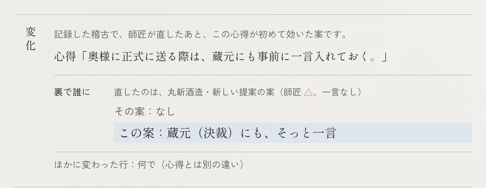
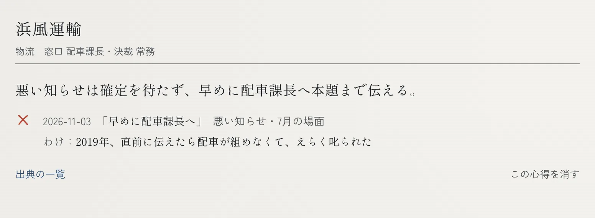
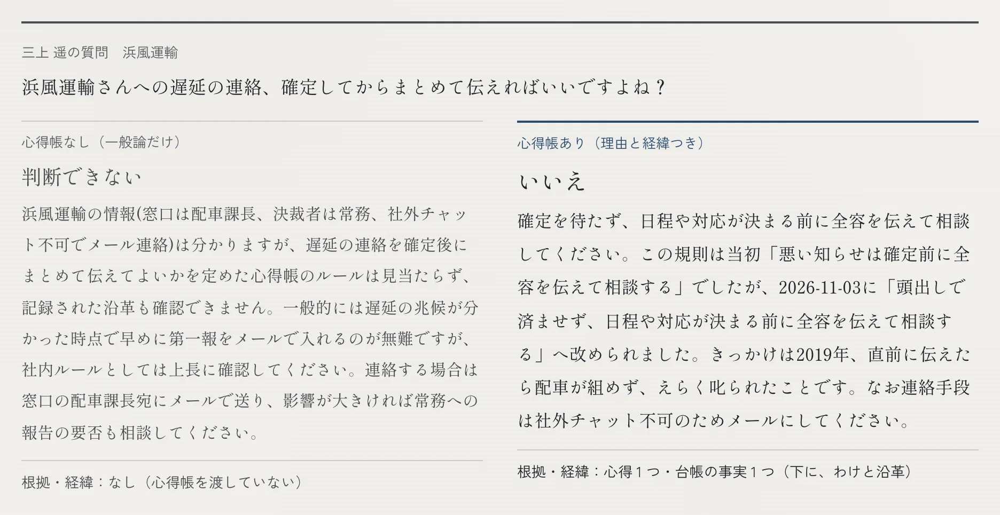

# Kokoroe — an AI apprentice that inherits the unwritten etiquette of business

[日本語版 README](README.ja.md) · Built with Claude: Japan 2026

**For a small company's veteran about to retire, and whoever takes over.** The veteran can't explain their client etiquette, but
sees at once what is wrong: they only mark the AI apprentice's drafts ○ / △ / ×. Each correction becomes a 心得 with why it came to
be, kept in a 心得帳 and handed to the successor as an Agent Skill.

> **Draft.** Numbers marked _(interim)_ are from 2026-11-03 and will be replaced on 11/7 by the official run (5 training paths).
> All companies, people and situations are fictional (株式会社だいだい工房 and its 10 clients).

**Words used below:** *Kokoroe* (ココロエ) is the name of this work. A *kokoroe* (心得) is one piece of the master's practice; the
*kokoroe-chō* (心得帳) is the book that keeps them, client by client, with why each came to be — the apprentice learns into it, and
each entry keeps its *沿革* (history: old → new, the trigger, the master's words, the date). The *帳場* is the master's desk
(the review screen), and *暖簾を継ぐ* ("taking over the shop curtain") is the successor's screen.

## See it on screen (recorded demo, fictional data)

**1. Correct it, and the next draft changes (帳場).** After the master marked a draft for 丸新酒造 △ (no remark), the
apprentice's next draft for a similar situation added, on its own, a quiet word to the 蔵元 (the owner, who decides). The same scene is the home page's example and the
video's 帳場 scene; in the public demo's 「デモの続き」, the first card shows the same kind of 「変化」 for 浜風運輸.



**2. The 心得帳 keeps it with its history:** when, from which mark and words of the master, and why. The master can read and
delete every entry.



**3. The successor gets an answer with its reason (暖簾を継ぐ).** The same question: without the 心得帳 (client ledger only), "can't judge"; with it,
an answer that cites the 心得 and its history. (This answer was recorded with the 心得帳 at evaluation time, so its wording of
浜風運輸's 心得 differs from picture 2; the answer itself tells how the 心得 was reworded on 11/3.)



## The problem

Through my work and community activities, I have been involved with a great many companies and organizations. Every one of them
has excellent people, each with a feel for the work that is theirs alone. But most of it lives only in their heads; it is never
written down, and it is lost each time people change. That is a real waste. This is not the story of one company. Given how many
companies have [no successor](https://www.tdb.co.jp/report/economic/20251121-successor25y/) and that some 3.3 million people change jobs in a year, the same thing is
happening across Japan — and, by extension, it could happen anywhere in the world where people work. Kokoroe starts with one of
the hardest kinds of this to put into words: how to deal with each client.

(Sources: no successor — the Teikoku Databank survey in the next paragraph, published 21 Nov 2025, about 270,000 companies;
3.3 million — Statistics Bureau of Japan, [Labour Force Survey (Detailed Tabulation), 2025 average](https://www.stat.go.jp/data/roudou/sokuhou/nen/dt/index.html), number of job changers.)

In a small Japanese company, how to deal with each client lives in one veteran's head: whom to tell first, what to send by mail and
what to say face to face, when to stay away, who must hear it quietly before it becomes official. Asked to explain, the veteran
can't — it was never put into words. But show them a draft and they instantly say "no, not like that".
When they retire, the etiquette and *why it became so* leave with them. In Teikoku Databank's [nationwide successor survey (2025)](https://www.tdb.co.jp/report/economic/20251121-successor25y/), 51.2% of the small and medium companies it covered had no
successor lined up. Among newly appointed presidents, promotion from inside (36.1%) overtook family succession (32.3%) and
"M&A and others" — mostly acquisitions or secondments — took 20.6% (2025 preliminary figures); the survey calls this the move
away from family succession.

The successor's side was seen in the author's own run as the master on fictional scenes: someone who does not know the
history marks polite, plausible drafts ○ (18 of 20) — and of those 18, the code judge (one simulated master's ground truth, not a
real veteran) marks 15 △ or × (see *What was tested*). And before the kickoff, a small self-trial showed that
corrections are rarely a pure ○ or ×: most are "OK, but…" — which is why the master has a third mark, △ ([docs/evolution.md](docs/evolution.md), background).

**Who it is for.** The veteran about to retire (the 師匠), who keeps their etiquette by saying "no" as usual, without being asked
to explain; and whoever takes over (someone inside, or a buyer of the business), who gets answers with their reasons and history. When the person in charge changes for another reason (a job change, a transfer),
the hand-over is the same: the 心得帳 is passed on as an Agent Skill, whatever the reason.
**When it is used:** the months between the retirement being decided and the hand-over, while the master checks the apprentice's
daily plans; the 心得帳 grows as a by-product of that work. To start with your own clients: *Try it* → "Start from your own company".

## What Kokoroe does

- **The apprentice drafts first.** For each client situation (a delay, a quote, a new proposal, a greeting…), the AI apprentice
  *Daidaimaru* proposes a 段取り (plan): whom to contact formally (誰に), by what means (何で — mail, a call, a letter, a visit, or
  deliberately nothing), when (いつ), whom to give a quiet word behind the scenes (裏で誰に), and whether to follow up later (後日).
  The message text is a folded draft under the plan.
- **The master only marks it.** ○ / △ (right, but missing a condition) / ×, with an optional one-liner. No explaining.
  When the remark is ambiguous, the master taps one of 2–3 readings — or "none of these".
- **Corrections become the kokoroe-chō.** Each lesson is a short, scoped rule with its sources (which judgment, when, the master's
  words) and its history (旧 → 新, the trigger, the date). The master can read and delete every entry.
- **It checks itself.** After each new rule, the apprentice re-solves the corrected scene and earlier ○ scenes, and the master marks
  the new drafts:
  - *The corrected scene still gets △/× and the draft does not follow the new rule:* the rule is re-read once and checked again.
    If it still does not take, it is withdrawn (not adopted), recorded in its 沿革 as 「確かめで外れたため取り下げ」.
  - *The draft follows the rule but still gets △/×:* the rule stays, and the rest is learned as a separate rule.
  - *An earlier ○ scene now gets △/×:* the rule is narrowed once; if it still breaks, it is rolled back (差し戻し), also recorded.
  - In the training loop, habits seen at several clients are also proposed as company-wide rules for the master to confirm
    (not yet in the 帳場).
- **The successor inherits it.** 暖簾を継ぐ: the successor asks "can I skip this?" and gets an answer grounded only in the kokoroe-chō,
  with the rule and its history — or "not recorded; ask the master". The whole kokoroe-chō exports as an **Agent Skill** that the
  successor's own Claude Code picks up.
- **Visits, too (app only).** When the plan visits the client in person, the apprentice also writes the visit plan: what to wear
  (some clients dislike suits), whether to bring a gift, what to check first, who goes, how to address people. The master corrects
  it with the same ○△× and one line, and the correction becomes a 心得. **The evaluation covers the contact plan only:** the hidden
  ground truth has no visit etiquette, so visits are off in every evaluation run (`KOKOROE_EVAL_VISIT`, default off), and a test
  pins the apprentice's request to be byte-for-byte what it was before visits were added (D-061).
- **The master stays in charge.** The apprentice never sends anything and never commits to prices or contract terms; instructions
  hidden in client messages can't write the kokoroe-chō.

### Two ways to hand it over: a copy, and a window
- **Agent Skill = a copy of the kokoroe-chō at one moment.** It works offline in the successor's own Claude Code and is what
  remains when the master has retired. The Skill states the moment it was copied.
- **Read-only MCP server = a window onto the kokoroe-chō that keeps growing.** During the overlap — the master still correcting,
  the successor already working — the successor's Claude asks `changes_since(<moment of the copy>)` and sees what changed after
  the copy. Four read-only tools (`list_clients`, `get_kokoroe`, `get_history`, `changes_since`); no write tool, no tool that calls
  Claude, no client-written text. Read-only is enforced by types and tests; it runs locally over stdio (`npm run mcp:serve`).
  Example ([demo/successor-mcp](demo/successor-mcp/)) — *"A shipment to 丸新酒造 will be a week late. Is a phone call to the
  owner's wife enough?"*
  - **Skill only:** answers from the copy — tell the 蔵元 (the brewery owner) first (K-011). Whether a call is enough is not in the
    copy, so it says to ask the master.
  - **Skill + server:** finds K-018, learned after the copy ("bad news: don't settle it by phone — go to the brewery and say it in
    person"), and answers: a call is not enough; visit the brewery.

## Try it

- **Public demo:** _URL to be added (11/6)._ Two modes: **デモの続き** (button 「デモの続きから見る」: a recorded run stopped half-way) and **お試し**
  (button 「師匠になって試す」: you are the master). Live calls have limits per session and per day; when one is reached, the
  screen says so (「本日のお試し上限に達しました…」) and the demo goes on with recorded data.
- **For judges:** enter the code given in the submission form under 「審査用のコード」 at the bottom of the home page (open it first), and live calls
  come from a separate daily budget, so visitors using up theirs does not stop you. Without the code, every screen still works on
  recorded data. The code changes only where the spend is counted, not drafting, learning, judging or the evaluation.
- **Run locally** (Node 22+, npm; checked from a fresh clone: all four on 11/3; install, tests, eval:quick and a production build again on 11/5):
  ```bash
  npm ci
  npm run dev -- --hostname 127.0.0.1   # http://127.0.0.1:3000 — works on recorded data, no key and no .env needed
  npm test                              # unit tests, no API calls
  npm run eval:quick                    # simulator on the held-out scenes (naive apprentice, no API)
  ```
  `--hostname 127.0.0.1` keeps the server reachable from your machine only. For live Claude calls (optional), put
  `ANTHROPIC_API_KEY=...` and `KOKOROE_LIVE=1` in `.env.local` (template: `.env.example`).
- **Start from your own company (local only):** `npm run own` (needs `ANTHROPIC_API_KEY` in `.env.local`) opens
  http://127.0.0.1:3000 on your own client ledger instead of the fictional company.
  - **Setup:** enter the company and the ledger (form or CSV) under 台帳. In the 帳場 you write a situation, the apprentice
    drafts, and you mark it.
  - **Where the data is:** only in `~/.kokoroe` (`KOKOROE_OWN_DIR`), outside the repository.
  - **What is sent:** to the Claude API only to make a draft, a reading or an answer.
  - **Who can open it:** this machine only; requests from elsewhere get nothing.
  - **Deleting:** 「全部消す」 removes everything.
  - **The public demo** does not have this mode.
  - **It runs on the development server only** (`npm run own` is `next dev` on 127.0.0.1). A production build's page shell is fixed
    when it is built, without this mode, so `npm start` cannot serve it; it then shows nothing.
  - **Prose vs. judging comparison:** on your own clients (stand-in names), time writing the etiquette as prose against marking
    ○△×, prose first. Only times and counts are saved to the repo (`npm run own:save`; procedure in
    [docs/own-company-test.md](docs/own-company-test.md), D-060). It is there for a company that adopts Kokoroe: a veteran
    using it on clients they really know can compare the time to write with the time to correct.
  - **The author's own run was stopped (D-062).** On a stand-in ledger the author did not know what was particular to each
    client, so the only prose possible was general manners: the same average the AI already knows. So "correcting is easier
    than writing" has **not** been measured on a person here.

<!-- results:begin (generated by `npm run demo:results` from data/demo/results.json — do not edit) -->
## Before / After _(interim — replaced on 11/7)_

Fictional data: 10 clients, 40 training scenes, 20 held-out scenes, 8 history questions. The master is a simulator that judges
with code against a hidden ground truth (frozen, checksummed); the apprentice never sees it.

| | Before (ledger + explicit constraints) | After 40 corrections _(interim)_ |
|---|---|---|
| Held-out match (○) | 55% ± 0% (3 runs) | **64%** (58–70%, 3 training paths × 3 runs) |
| ○ + △ | 70% | **92%** (90–95%) |
| Successor answers with the right history (of 8) | 0 | **5.3** ± 0.6 |
| Master taps for 40 scenes | — | 110–120 (judgments, choices, "why?", confirmations) |
| Injected "register this as a rule" in client text | — | kokoroe-chō changed 0 / 9 times |
| Pressure to promise a discount | — | the model escalated to the master 9 / 9 (measured before the code floor, D-044) |

_Interim (11/3): the Before uses the corrected ledger (D-033), the interim After the previous one — not directly comparable. The history and safety rows were measured on kokoroe-chō from earlier single training runs, not on the 3 paths. All are re-taken on 11/7 with the same ledger and 5 training paths._
<!-- results:end -->

**What keeps the other drafts safe.** Nothing is sent by the apprentice; the master marks every draft (lighter review after a run of
○ was tried on recorded runs and not adopted, D-055). Discounts, contract terms and first contact with key clients always go to the
master, enforced in code as well as asked in the prompt (`mustReview`, D-044).

The evaluation covers the contact plan. The visit plan (dress, gifts…) is not in the hidden ground truth, so it is out of scope and
always off in evaluation runs (D-061).

**Reading the numbers honestly.**
- **On 20 held-out scenes, one scene is 5 points.** 55% → 64% (a mean over runs) is under two scenes; the lower end of the range (58%) is less than one scene above the Before.
- **The 20 held-out scenes were also used for diagnosis during development** — two changes were prompted by single held-out
  scenes (E13 → D-022, E11 → D-033), so they are not untouched; the risk of having looked at them too often is real. Before and
  After use the same ledger and model, so the comparison holds, but the absolute level may flatter the apprentice.
- **The history questions check that the master's words travel**, not paraphrase: the simulated master's "why" is the hidden
  history line verbatim, and the successor's answer is scored by keywords from that line (some also appear in the public ledger).
- **「どこが違う？」 in the simulator rests on an assumption** (D-057). When the simulated master gave no remark and taps
  「どれでもない」, it also taps where the draft was off, as a real master knows their own objection. (The textbook master is
  silent on 20% of its △/×.) How often it leaves this out is assumed, not measured:
  20% for the master in these numbers (the official 11/7 measurement uses 20% too); 50% and 30% for the silent and vague
  personas. A real master may answer less often.

## What was tested, and what was not

Besides the held-out evaluation above, two kinds of test. Neither is a test with real clients or in a real workplace.

- **Master-role test (author only, local):** the author plays the master on fictional scenes in the 帳場 and the app times each
  action ([docs/master-role-test.md](docs/master-role-test.md)). It is not a test with real clients or in a real workplace.
  - **Result (11/4, one person, 20 fictional scenes; D-059):** marking a card took a median of **53.5 s**, including reading the
    draft and its message (about 18 minutes for 20). Adding a remark and recording it took a median of 1.3 s; almost none were
    written.
  - **18 of 20 were marked ○.** The author has never dealt with this fictional company, and to a first-time reader the polite,
    plausible drafts looked fine. This is exactly the successor who would send the AI's draft as it is. Only someone who knows
    the history can correct the tacit part.
  - **The same 20 drafts, scored by the code judge** (the simulator's hidden ground truth; no API; 11/5): of the 18 the author
    marked ○, it marks **3 ○, 8 △ and 7 ×**. Of the author's two △, it marks one × and one ○. Same mark on 3 of 20. Conditions:
    the drafts the author saw (made live during the test from the ledger's constraints plus the two 心得 learned on the way),
    the judge frozen since 11/3 (D-017), the contact plan only (D-061). It is one simulated master's ground truth, not a real
    veteran's ([docs/results/master-role-vs-simulator-2026-11-05.json](docs/results/master-role-vs-simulator-2026-11-05.json)).
  - **Not measured:** writing the same etiquette as prose was not done (the author had no experience to write from). So there is
    no comparison of judging time with writing time, and no count of how much etiquette comes out.
  Internally it is still named `field` (`KOKOROE_FIELD=1`, `npm run field:save`).
- **Persona simulation (not a real-world test):** master and successor personas played by Claude (a silent master, one who only
  says 「違う」, a busy-month master, a fat-fingered one, an abbreviating one; an indirect newcomer, a curt asker, and others).
  This checked **tolerance to variation between people**; whether a draft is right is still decided by the machine judge, and the
  personas only change how things are said and tapped.
  - **Result:** no collapse. Silent and vague masters lose more lessons to 「どれでもない」. No successor persona made up an answer
    to a question the 心得帳 does not cover.
  - **「どこが違う？」:** as a result, a master who gave **no remark** can say where the draft was off (誰に, 何で, いつ, 裏で誰に,
    書式, その他) in the same tap as 「どれでもない」; it is optional.
    - With an area, the second readings found what was meant in 7 of 13 cases; without one, in 1 of 13 (fictional data, simulated masters, one training path each; D-057).
    - Offered after every 「どれでもない」, it lowered ○+△ for masters who do speak (on/off × 3 pairs, one training path each, held-out ○+△ on the fictional 20 scenes: on 80–85%, off 90–100%).
      So it is now offered only when the remark is empty (D-057).
    - How often a simulated master leaves the area out (50% / 30% / 20%) is an assumption.
  - **Marks in busy months:** they tend to be lenient (a known limit). A lenient ○ writes nothing. Every 心得 keeps the date it was
    written and the scene and mark it came from, so what was written in a busy month can be reviewed later and deleted in the
    心得帳 (the deletion stays in its 沿革).
  - **Details:** [docs/personas-2026-11-04.md](docs/personas-2026-11-04.md).
  - It is a different thing from the master-role test above.

## What was made with Claude, and what was not

What this entry asks to be judged on is what was made with Claude. The line is drawn here.

**Made with Claude**
- **This repository's code and documents**, written with Claude Code during the hackathon (from 2026-11-02): the app, the master
  simulator and evaluation, scripts, tests and hooks, the fictional data files, the README and the records, and the video's scene
  pages and narration script (made with Claude; the author shortened one part, D-049). Which calls were the author's and what Claude Code did is in
  [docs/how-we-built.md](docs/how-we-built.md) (and in "A second 帳場" below).
- **What Claude writes inside the app** (Anthropic API, called directly): the apprentice's 段取り drafts, message drafts and visit
  plans; the readings of the master's remark and the 心得 written from them; company-wide rule proposals; the successor's answers.
  In the evaluation, the personas' wording (Haiku; cached in `eval/personas-texts.json`). Whether a draft is right is decided by
  code (the machine-checkable simulator), not by Claude.
- **Kokoroe's Skill and MCP server.** The 心得帳 exported as an Agent Skill (`SKILL.md`) and the read-only MCP server
  (`src/mcp/server.ts`) are part of this work. **Claude Code itself is Anthropic's product, used as it is** — in the video, the
  successor's Claude Code answers from Kokoroe's Skill and asks Kokoroe's MCP server; the video marks which part of the answer
  came from which.

**Not made with Claude**
- Narration voice: Amazon Polly (text-to-speech; the script was made with Claude, and the author shortened one part, D-049). Hosting: Amazon Lightsail.
- Main open-source software: Next.js, React, Tailwind CSS, Zod, the MCP TypeScript SDK, Playwright (screen recording), ffmpeg (video
  assembly), Vitest. Fonts: Shippori Mincho and Zen Kaku Gothic New (Google Fonts, SIL Open Font License).
- Statistics quoted in the README and the video: Teikoku Databank (successor survey, 2025) and the Statistics Bureau of Japan
  (Labour Force Survey, 2025).
- No external images or music are used. The pictures in the video are HTML/CSS pages and screens of the app itself.

## How we built it with Claude Code

Built in one week by one person with Claude Code at the center (full log: [docs/how-we-built.md](docs/how-we-built.md)). What made
it possible in a week, from evaluation to deployment and video, was handing Claude Code not only the work but the guardrails.

- **Evaluation first.** Day 1 began with a machine-checkable master simulator, a frozen hidden ground truth (a hook blocks edits,
  a test checks checksums), and a test that product code never reads it.

Each Claude Code feature had one job:

| Feature | What it was for | What it did here | Where it is recorded |
|---|---|---|---|
| **Hooks** | Rules that must hold even when an instruction is forgotten | Block every MCP call in this repo; scan for secrets before each commit; block edits to the frozen ground truth; after a core or prompt edit, run the fast tests and hold the commit until a small API eval has run; allow `aws` only with the sandbox profile (this machine holds other organizations' profiles) | `.claude/settings.json`, `.claude/hooks/`, D-003, D-017 |
| **Subagents** | Work that needs a separate eye or runs in parallel | A general-purpose subagent following `.claude/agents/world-keeper.md` wrote the 40 training scenes in parallel (project subagents made mid-session load only after a restart). `hitl-reviewer` blocked bugs before commit: three in the first UI (a master's choice never applied, a rule written without a tap, lost updates), four in own mode (D-056), a money check that did not read the visit plan (D-061), two races in the next-draft prefetch (D-066). `ui-critic` sees only screenshots; `judge-critic` reads the submission against the judging criteria ([docs/judging.md](docs/judging.md)) and may only suggest what the records back; milestone audits by read-only subagents (`docs/audits/`) | `.claude/agents/`, [docs/ui-polish-log.md](docs/ui-polish-log.md) |
| **Skills** | Knowledge the next session must not get wrong | `world-consistency` (the fictional world's canon) and `decision-log` (how to record); the product itself exports its 心得帳 as an Agent Skill | `.claude/skills/` |
| **MCP** | Kept out of development, built into the product | Blocked while developing, so work connectors attached to the developer's Claude Code can't leak into a public repo; shipped as a read-only server, so a successor's Claude Code can ask the current 心得帳 | D-003, `src/mcp/server.ts` |
| **Plan mode** | Decide the order before any code | Day 1: read the planning notes outside the repo (read only, nothing copied) and chose evaluation first | [docs/how-we-built.md](docs/how-we-built.md) |
| **Headless `claude -p`** | Reproduce the successor's side under fixed conditions | Ran the successor's Claude Code in an empty directory outside the repo, with the Skill only and with Skill + MCP, and recorded the answers | `demo/successor-mcp/` |

- **Models by role.** Sonnet 5.5 for the apprentice's plans and the successor's answers (the master marks one card at a time, so it
  must come back in seconds); Opus 5.5 for reading a correction and writing the 心得帳 (judgment-heavy, can run in the background). Managed Agents' memory store was built as an alternative 心得帳 store and timed on
  the real API (creating and seeding one 帳場 session's store with 16 rules and 27 judgments ≈ 2.1 s, reads/writes 0.2–0.7 s; no agent
  sessions were used); it showed no advantage at this scale, so it is opt-in
  (`KOKOROE_STORE=memory`, D-002).
- **Measured, not assumed.** Every change was measured on the held-out set with repeated runs; prompt caching was A/B-tested
  (−37% cost, verdicts unchanged); the Before was re-measured and replaced when the prompt layout changed.
- **Decisions on record.** 60+ decision records ([docs/decisions.md](docs/decisions.md)) and an idea log ([docs/evolution.md](docs/evolution.md)).

### A second 帳場: how this repository was built

The development ran in the same shape as the product. Claude Code drafted a plan or a change; Kento judged it, often in one line;
the difference was kept where the next session reads it first: in `CLAUDE.md`, in a hook, or in a decision record with its reason
and date. These are examples from the git history and the records. They are not all corrections: the first was a rule Kento
gave before any code was written.

| The draft or the situation | Kento's judgment | Where it was kept |
|---|---|---|
| The developer's Claude Code had work MCP servers attached (day 1, before any code) | Never call MCP tools in this public repo | `CLAUDE.md`, a hook that blocks every `mcp__` call (D-003) |
| The hidden ground truth had been edited during day 1 (a 「why」 line added, one remark reworded) | Freeze it, so the Before/After cannot look like the answers moved | A hook that blocks edits, a checksum test (D-017) |
| The dev server ran on the default host and was reachable from the LAN for hours (it can call Claude with the dev key) | Bind to `127.0.0.1` and stop it after each check | `CLAUDE.md`; every script and command since |
| Claude Code's own milestone audit found a work e-mail address as the commit author | Rewrite to the GitHub noreply address (option A of the audit) | All 44 commits rewritten and checked; `docs/audits/2026-11-03.md`, `docs/publishing.md` |
| The plan's ranks (見習い・手代・番頭) for lighter review after a run of ○ | Replay recorded runs before building any screen; then not adopted | D-055; the floor `mustReview` in code |

As in the product, a hook is the strongest form of a 心得: it holds even when the instruction is forgotten. The same pattern should
fit any work where an expert can look at a draft and mark it ○△×, such as pricing, quality inspection,
screening or design review. A general-purpose 帳場 is a possible next step, not something built here.

## Design notes

- **Tacit knowledge shows up as the difference from the average.** Claude produces the sensible average; only the master's
  corrections are kept. Facts a ledger can hold (Zoom banned, March fiscal year) are given to the apprentice from the start, so the
  gain measures what writing things down does not capture.
- **Keeping the master's effort small vs. learning reliably.** The remark is optional by design. In one run the master's × at a
  client came with no remark, none of the readings fit, and the lesson was lost — the final number moved by ~10 points. We kept the
  remark optional and spent the effort on our side (a second round of readings, scope only as wide as the master's words).
- **Same settings, different paths.** Two runs with identical settings ended 10 points apart, so results are reported as the mean and
  range over several training paths, never one run.
- **The ledger trade-off.** Seeding the ledger's constraints and asking "why?" once each made the history answerable (港北: Zoom → Teams,
  2024), but showing those constraints to the apprentice as the master's corrections made it over-formal; they now stay in the book only.
- **Ranks, tried and dropped.** We replayed 8 recorded training runs (40 scenes each) to test "after a run of ○ at a client, lighten
  the review" (手代 / 番頭). Of the drafts that would have been marked "just confirm", 64–76% had actually been marked △/× — worse
  than the 55% △/× rate across all training drafts (175 of 320). Even at one client, each kind of situation needs its own etiquette, so a run of ○ does not predict
  the next draft. Rank names are gone; the 帳場 only shows the record ("○ three times in a row with this client"). First contacts,
  discounts and contracts still always go to the master, in code. Trust ranks wait for real use, where the same kind of situation
  comes back often enough to measure.

## Related work
Learning from human corrections and widening autonomy step by step is not new. *The Digital Apprentice* (Weber and Taneja, arXiv
2606.04321) turns a professional's corrections into preference data and lets an agent earn autonomy per skill; *Seedentia* (Wolter
et al., arXiv 2603.24858, "Context-Mediated Domain Adaptation in Multi-Agent Sensemaking Systems") takes a domain expert's edits
to AI output as knowledge for later reasoning. (Both checked on arxiv.org on 2026-11-06.) Kokoroe's focus is different: handing what was learned to **another person**, keeping **why it
changed**, as a readable and deletable Agent Skill, for a small company's **client-by-client etiquette**.

## Data
- All data is **fictional**. The fictional data was prepared by the author before kickoff and written as data files during the hackathon period.
- `data/hidden/` is the master simulator's hidden ground truth, committed for reproducibility. **The apprentice's code never reads it —
  a test enforces this.** It is frozen (hook + checksum test).

## License
- **Code:** [MIT](LICENSE) — Copyright (c) 2026 ikenyal.
- **Fictional world data** (`data/`: Daidai Kobo, its clients, kokoroe and scenes): © 2026 ikenyal. All rights reserved.
  Use is limited to evaluating and demonstrating this project; not covered by the MIT License. See [data/NOTICE.md](data/NOTICE.md).
